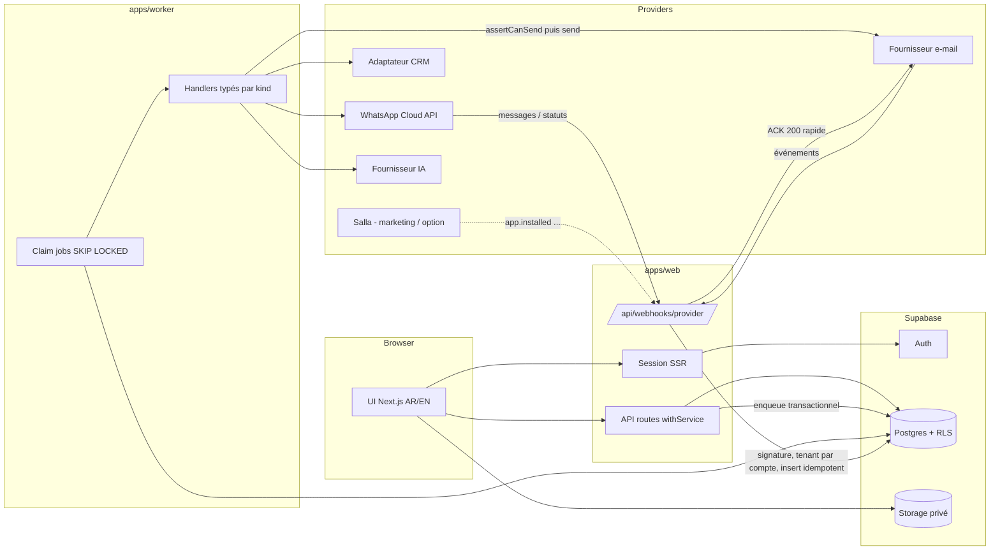
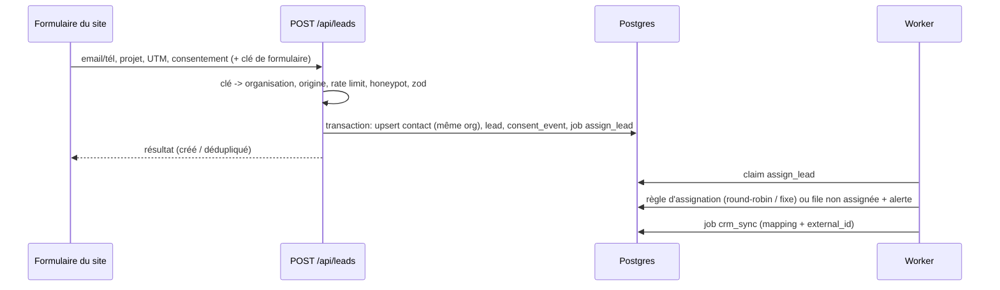
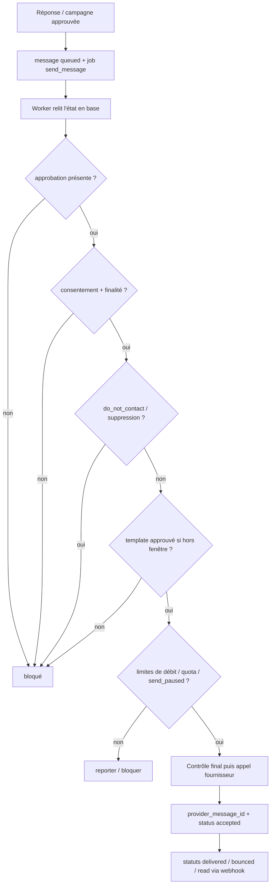
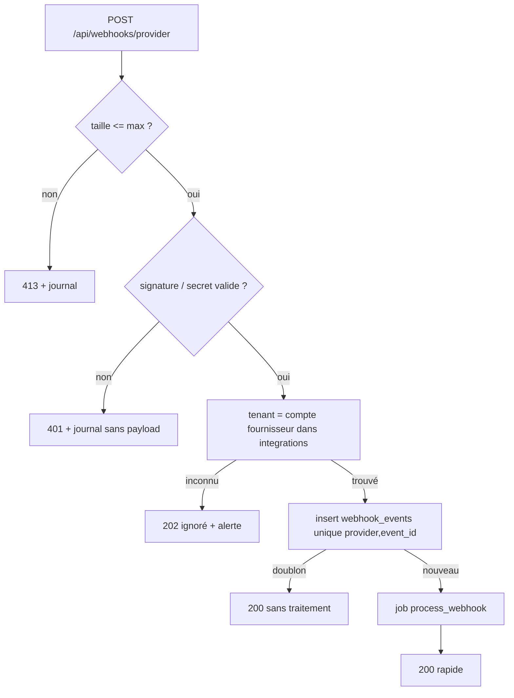

# Flux de données — Fusion Leap AI Growth

Sources : spec §6, §8, §9.1–§9.5, §10, §11. Les noms de routes sont des exemples de la spec (§8).

## 1. Vue d'ensemble

## 2. Capture d'un lead (§9.1)

## 3. Envoi sortant et contrôle final (§9.2, §9.3, §5.7)

## 4. Webhook entrant (§8, §11)

## 5. Cycle de vie d'une campagne (§10)
`draft → pending_approval → approved → scheduled → running → completed` (+ `paused`, `rejected`, `failed`). Approbation : gel du `segment_snapshot` ; planification : job `campaign_fanout` par lots ; chaque message : `campaign_id`, `segment_snapshot_id`, `idempotency_key` ; toute modification après approbation → `pending_approval`.

## 6. Agents IA (§9.5)
Contexte minimal (fonctions de lecture filtrées par organisation/projet) → `AiAdapter` → brouillon enregistré en `draft` + `agent_runs` ; aucune écriture externe ; envoi seulement par un humain via le chemin 3.

## 7. Frontières de confiance
| Frontière | Contrôle |
|---|---|
| Navigateur → API | session SSR + adhésion revérifiée à chaque requête (ADR 005) |
| Navigateur → base (Data API) | RLS par opération ; pas de `service_role` |
| Fournisseur → webhook | signature/secret, taille, dédup, tenant par compte fournisseur |
| Worker → fournisseur | `service_role` + `organization_id` explicite + contrôle final |
| Contenu client → IA | délimité, non fiable, aucun outil de mutation |
| Secrets | `private.secrets` chiffré (ADR 004), jamais renvoyé au navigateur |
