# ERD — Fusion Leap AI Growth (ADR 007)

Toutes les tables tenant portent `organization_id` (FK composites `(organization_id, x_id)`) ; pour la lisibilité du diagramme, `organization_id` n'est dessiné que sur la relation `organizations ||--o{ …`. Les tables marquées **(ajout ADR)** sont absentes du §7 de la spec ; leur origine est donnée dans le tableau sous le diagramme.

```mermaid
erDiagram
  organizations ||--o{ organization_members : has
  organizations ||--o{ invitations : invites
  organizations ||--|| subscriptions : "1 active"
  plans ||--o{ subscriptions : defines
  organizations ||--o{ usage_counters : meters
  organizations ||--o{ support_sessions : "support access"
  organizations ||--o{ audit_logs : records
  organizations ||--o{ idempotency_keys : dedups
  organizations ||--o{ notifications : alerts
  organizations ||--o{ projects : owns
  projects ||--o{ products : offers
  projects ||--o{ audience_segments : targets
  projects ||--o{ form_keys : "capture keys"
  organizations ||--o{ pipelines : configures
  pipelines ||--o{ pipeline_stages : orders
  organizations ||--o{ contacts : owns
  contacts ||--o{ consent_events : consents
  contacts ||--o{ leads : becomes
  projects ||--o{ leads : sources
  pipeline_stages ||--o{ leads : "current stage"
  leads ||--o{ deals : converts
  pipeline_stages ||--o{ deals : "current stage"
  leads ||--o{ activities : timeline
  contacts ||--o{ activities : timeline
  projects ||--o{ assignment_rules : routes
  integrations ||--o{ crm_field_mappings : maps
  organizations ||--o{ integrations : connects
  integrations ||--o{ channels : exposes
  channels ||--o{ message_templates : templates
  channels ||--o{ conversations : carries
  contacts ||--o{ conversations : talks
  conversations ||--o{ messages : contains
  campaigns ||--o{ messages : sends
  segment_snapshots ||--o{ messages : "targets"
  organizations ||--o{ suppressions : blocks
  organizations ||--o{ webhook_events : receives
  organizations ||--o{ jobs : queues
  audience_segments ||--o{ segment_snapshots : freezes
  projects ||--o{ campaigns : runs
  audience_segments ||--o{ campaigns : uses
  segment_snapshots ||--o| campaigns : "frozen at approval"
  campaigns ||--o{ campaign_assets : versions
  campaigns ||--o{ campaign_spend : cost
  campaigns ||--o{ leads : attributed
  organizations ||--o{ agent_runs : logs
  projects ||--o{ knowledge_items : informs
  organizations ||--o{ domain_events : emits
  projects ||--o{ metric_daily : aggregates
  integrations }o--|| secrets : "secret_ref (schema private)"

  organizations {
    uuid id PK
    text slug UK
    jsonb settings
  }
  organization_members {
    uuid organization_id FK
    uuid user_id
    app_role role
    member_status status
  }
  invitations {
    uuid organization_id FK
    text email_normalized
    text token_hash UK
  }
  plans {
    uuid id PK
    text code UK
    jsonb limits
  }
  subscriptions {
    uuid organization_id FK
    uuid plan_id FK
    subscription_status status
  }
  usage_counters {
    uuid organization_id FK
    text metric
    date period_start
    bigint value
  }
  support_sessions {
    uuid organization_id FK
    uuid admin_id
    timestamptz expires_at
  }
  projects {
    uuid organization_id FK
    project_type type
    jsonb settings
  }
  contacts {
    uuid organization_id FK
    text email_normalized
    text phone_e164
    boolean do_not_contact
  }
  leads {
    uuid organization_id FK
    uuid contact_id FK
    uuid project_id FK
    uuid stage_id FK
    uuid assignee_id
    jsonb utm
  }
  deals {
    uuid organization_id FK
    uuid lead_id FK
    uuid stage_id FK
    numeric value
  }
  integrations {
    uuid organization_id FK
    text provider
    text external_account_id
    uuid secret_ref
  }
  channels {
    uuid organization_id FK
    channel_type type
    boolean send_paused
  }
  conversations {
    uuid organization_id FK
    uuid contact_id FK
    uuid channel_id FK
    conversation_state state
  }
  messages {
    uuid organization_id FK
    uuid conversation_id FK
    text provider_message_id
    message_status status
    text idempotency_key
  }
  campaigns {
    uuid organization_id FK
    uuid project_id FK
    campaign_status status
    uuid segment_snapshot_id FK
  }
  jobs {
    uuid organization_id FK
    text kind
    job_status status
    text idempotency_key
  }
  agent_runs {
    uuid organization_id FK
    agent_type agent_type
    text prompt_version
  }
  secrets {
    uuid id PK
    bytea ciphertext
    int key_version
  }
```

Hors diagramme (liaisons évidentes) : `webhook_events.provider/external_event_id` unique ; `platform_admins` (schéma `private`) ; `rate_limit_buckets` ; `salla_stores` (différé, feature flag).

## Tables ajoutées par rapport à la spec §7 (« ajout ADR »)
| Table | Origine |
|---|---|
| `pipelines`, `pipeline_stages` | E1 (spec §5.3 « مراحل قابلة للإعداد ») |
| `knowledge_items` | E4 (spec §9.5 « قاعدة معرفة الشركة ») |
| `message_templates` | E5 (spec §9.3 templates) |
| `usage_counters` | E6 (spec §10 consommation par cycle) |
| `support_sessions`, `private.platform_admins` | E7, G-R4 (spec §2) |
| `assignment_rules`, `crm_field_mappings` | E8 (spec §9.1) |
| `segment_snapshots` | E9 (spec §7, §10) |
| `plans` | E10, G-D1 (spec §10 limites par plan) |
| `suppressions` | G-D5 (spec §9.2 rebonds, désinscription) |
| `domain_events` | G-D6 (spec §6 « events », §10 événements de mesure) |
| `invitations` | G-R8 (spec §5.1 invitations) |
| `idempotency_keys` | spec §8 (`Idempotency-Key`) |
| `form_keys` | spec §8 `POST /api/leads` (identification de la source, §9.1 étape 2) |
| `campaign_spend` | spec §4.1, §10 (dépenses importées) |
| `rate_limit_buckets` | G-D9 (spec §6 limites de débit) |
| `notifications` | spec §5.8, §9.1 étape 4 (alertes) |
| `private.secrets` | ADR 004 (spec §7 `secret_ref`) |
