# Plan de développement — Fusion Leap AI Growth (proposition Jour 0, à valider)

**Statut : PROPOSÉ — en attente du message « PLAN VALIDÉ ».** Aucun code n'est écrit avant. Ce plan s'appuie sur la spec v1.0 (`docs/spec/…`), les analyses (`docs/analysis/…`) et le plan fourni (`docs/plan/provided-plan.pdf`). Il le **reprend dans l'ensemble** et en liste les différences au §8.

Hypothèses de calendrier (reprises du plan fourni, **non issues de la spec**, qui ne donne aucune durée) : 1 développeur·se + 1 agent IA, 6 h productives/jour, 5 j/semaine, jours fériés exclus (18 nov, 1er jan, 11 jan, 14 jan). Vérifié par calcul : du lun 9 nov 2026 au mar 9 fév 2027 = **63 jours ouvrés = 378 h** (J0…J62).

Réponses Q1–Q5 : **l'hypothèse d'exécution du §14 de la spec est confirmée** (CRM interne source de vérité, un fournisseur e-mail, numéro WhatsApp de test officiel, Salla en mode marketing sans lecture de boutique, plans SaaS activés manuellement). Les arbitrages E1–E12 / G-xx des `gaps-and-questions.md` sont pris **par défaut selon les propositions**, et seront formalisés en ADR au J1 ; ils restent à confirmer par vous.

---

## 1. Phases, dates, gates

| Phase | Dates | Jours | Heures | % cumulé | Gate (condition de passage, spec §12) |
|---|---|---|---|---|---|
| 0 — Découverte technique | 9 → 12 nov | J0–J3 (4) | 24 h | 6,3 % | **G0/G0'** : plan validé, ADR 001–008 « Accepted », sources de vérité et intégrations initiales arrêtées |
| 1 — Fondations | 13 nov → 1er déc | J4–J15 (12) | 72 h | 25,4 % | **G1** : test d'isolation de deux entreprises réussi (UI, API, RLS, worker) |
| 2 — Ventes / CRM | 2 → 17 déc | J16–J27 (12) | 72 h | 44,4 % | **G2** : parcours lead → deal gagné fonctionnel, avec historique |
| 3 — Canaux | 18 déc → 7 jan | J28–J41 (14) | 84 h | 66,7 % | **G3** : envoi, réception et arrêt sûrs (webhook dupliqué, panne fournisseur, désabonnement en cours d'envoi) |
| 4 — Croissance | 8 → 27 jan | J42–J53 (12) | 72 h | 85,7 % | **G4** : campagne complète et auditable ; aucun brouillon IA ne part sans validation |
| 5 — Pilote SaaS | 28 jan → 9 fév | J54–J62 (9) | 54 h | 100 % | **G5** : les 10 critères d'acceptation §13 réussis |

Ordre de priorité de la spec §5 respecté : **isolation et adhésion → CRM et capture → inbox → campagnes → IA → rapports → intégrations élargies.**

Règle de passage de gate : chaque `docs/checkpoints/Cn.md` conclut par GO / NO-GO ; sans GO, la phase suivante ne démarre pas.

---

## 2. Plan quotidien

Format : objectif · tâches (h, total 6 h) · fichiers/migrations attendus · tests · critère de validation. **« ⚠ »** = estimation jugée tendue ou irréaliste, avec proposition. La cible % est le cumul visé le soir. Toute migration a sa procédure de retour documentée (voir ADR 006 : Supabase est « forward-only », le « down » est un script dans `supabase/rollbacks/`).

### Phase 0 — Découverte technique

**J0 · lun 9 nov · cible 1,6 %** — Analyse (aucun code).
- Tâches : préparation dépôt 0,5 · Prompt 0-A 1,5 · relecture + réponses 1,5 · Prompt 0-B 1 · corrections et validation, commit 1,5.
- Fichiers : `CLAUDE.md`, `docs/analysis/{spec-understanding,gaps-and-questions}.md`, `docs/plan/development-plan.md`, `docs/progress/journal.md`.
- Validation (G0) : 15 invariants repris sans ajout ni oubli (24 listés avec compléments) · E1–E12 identifiés · ordre §5 respecté · critères §13 reliés à une phase et à un test · aucune techno hors stack sans ADR · message « PLAN VALIDÉ ».

**J1 · mar 10 nov · cible 3,2 %** — ADR et modèle de données.
- Tâches : ADR 001–006 2,5 · ADR 007 (modèle réconcilié) 2 · ERD Mermaid 1 · revue 0,5. ⚠ ADR 004/005 touchent la sécurité : prévoir la relecture de votre côté le jour même.
- Fichiers : `docs/adr/001…007-*.md`, `docs/adr/014-rbac-matrix.md`, `docs/architecture/erd.md`.
- Tests : n/a (relecture croisée ERD ↔ spec §7).
- Validation : format MADR · chaque table tenant a `organization_id`, index et stratégie RLS décrite · E1–E12 et G-D1…G-D12, G-R1…G-R8 tranchés · matrice des rôles complète (aucune case « ? »).

**J2 · mer 11 nov · cible 4,8 %** — Intégrations et flux de données.
- Tâches : fiche CRM 1 · fiche e-mail 1,5 · fiche WhatsApp 1,5 · fiche Salla 1 · diagramme de flux 1.
- Fichiers : `docs/integrations/{crm,email,whatsapp,salla}.md`, `docs/architecture/data-flow.md`, ADR 008, ADR 010 (hébergement), ADR 011 (i18n), ADR 012 (fournisseur IA).
- Validation : chaque fiche cite documentation officielle + date ; limites de débit, signatures webhook, scopes notés ; plan B écrit ; « À CONFIRMER » pour ce qui n'est pas vérifiable.

**J3 · jeu 12 nov · cible 6,3 %** — Menaces, tests, backlog ; **Gate G0'**.
- Tâches : threat model STRIDE 2 · stratégie de test 1,5 · backlog J4–J62 1,5 · checkpoint 1.
- Fichiers : `docs/security/threat-model.md`, `docs/testing/strategy.md`, `docs/backlog/JXX.md`, `docs/checkpoints/C0.md`.
- Validation : chaque menace → un contrôle + un test ; backlog couvre chaque jour et chaque critère §13 ; ADR 001–008, 010–012, 014 « Accepted ».

### Phase 1 — Fondations

**J4 · ven 13 nov · cible 7,9 %** — Monorepo opérationnel et CI.
- Tâches : pnpm + Turborepo et 7 dossiers §6 2 · TS strict, ESLint, Prettier, Vitest 1,5 · CI GitHub Actions 1,5 · README 1.
- Fichiers : `package.json`, `pnpm-workspace.yaml`, `turbo.json`, `apps/{web,worker}`, `packages/{domain,adapters,permissions}`, `.github/workflows/ci.yml`.
- Tests : smoke Vitest par package. Validation : `pnpm install && lint && typecheck && test` verts en local et CI ; arborescence = §6 ; versions épinglées (vérifiées dans la doc officielle) et lockfile commité.

**J5 · lun 16 nov · cible 9,5 %** — Supabase local et environnements.
- Tâches : Supabase CLI + local 1,5 · validation zod de l'env, séparation serveur/client 2 · `.env.example` dev/staging/prod 1 · garde-fou CI anti-fuite `NEXT_PUBLIC_*` 1,5.
- Fichiers : `supabase/config.toml`, `packages/domain/env/*`, `.env.example*`, `scripts/check-client-bundle.*`.
- Tests : démarrage refusé si variable manquante ; garde-fou testé par une fuite volontaire. Validation : `pnpm db:reset` fonctionne ; module env typé.

**J6 · mar 17 nov · cible 11,1 %** — Migrations du noyau tenant.
- Tâches : `organizations`, `organization_members` (enum rôles), `subscriptions`, `usage_counters` 3 · schéma `private` + `is_member`, `has_role` (security definer) 2 · seed 1.
- Fichiers : `supabase/migrations/*_core.sql`, `supabase/rollbacks/*`, `supabase/seed.sql`. Aucune politique RLS encore.
- Tests : contraintes (unicité adhésion, enum). Validation : 6 rôles de la spec existent ; fonctions d'aide non exposées à la Data API ; seed = 2 entreprises + 1 utilisateur à 2 rôles.

**J7 · jeu 19 nov · cible 12,7 %** — RLS du noyau et harnais `test:rls`. ⚠ Tendu (les 2 sujets sont critiques) : faire le **harnais d'abord** (2,5 h) puis les politiques en test-first ; absorber un dépassement par le créneau « corrections » du J15.
- Tâches : politiques select/insert/update/delete par rôle 2,5 · revue GRANT + Data API 1 · harnais JWT simulés 2,5.
- Fichiers : `supabase/migrations/*_core_rls.sql`, `supabase/tests/*`, script **« schema lint »** (toute table `public` : `organization_id not null`, index, RLS activée, politiques par opération ; échec CI sinon).
- Tests : matrice utilisateur × entreprise × CRUD ; changement d'`organization_id` d'une ligne refusé ; Analyst ne peut rien écrire ; non-membre ne voit rien.
- Validation : critère §13-1/2 au niveau RLS ; `test:rls` en CI.

**J8 · ven 20 nov · cible 14,3 %** — Auth SSR bilingue. ⚠ Tendu (SSR + middleware + 3 pages + i18n/RTL en 6 h).
- Tâches : clients Supabase SSR serveur/navigateur (doc officielle actuelle) 2 · middleware et routes protégées 1,5 · inscription/connexion/reset AR/EN 2,5.
- Fichiers : `apps/web/lib/supabase/*`, `apps/web/middleware.ts`, `apps/web/app/(public)/*`, `(app)/*`, `messages/{ar,en}.json` (selon ADR 011).
- Tests : redirection sans session, accès avec session, déconnexion. Validation : session rafraîchie côté serveur ; `dir=rtl` en arabe.

**J9 · lun 23 nov · cible 15,9 %** — Organisations et contexte actif.
- Tâches : `POST /api/orgs` transactionnel (fonction `security definer`, G-R7) 2 · `getTenantContext()` revérifié à chaque requête 2 · sélecteur 1,5 · tests 0,5.
- Fichiers : `apps/web/app/api/orgs/route.ts`, `apps/web/lib/tenant-context.ts`, migration `create_organization()`.
- Tests : `organization_id` forgé → 403 ; deep link vers l'ancienne organisation → refus (scénario 5 partiel). Validation : organisation + membre owner + subscription trial créés atomiquement.

**J10 · mar 24 nov · cible 17,5 %** — Invitations et RBAC applicatif.
- Tâches : `packages/permissions` (matrice ADR 014) 2 · invitations avec jeton haché expirant 2 · page Membres : rôle, retrait, transfert de propriété 2.
- Fichiers : `packages/permissions/src/*`, migration `invitations`, `apps/web/app/(app)/members/*`.
- Tests : table-driven exhaustifs rôle × action ; Company Admin ne peut pas transférer la propriété. ⚠ L'e-mail d'invitation ne peut pas passer par l'adaptateur e-mail (J31) : au J10, **lien d'invitation affiché + boîte de capture locale** ; l'envoi réel est branché en J31–J33.

**J11 · mer 25 nov · cible 19,0 %** — Couche service.
- Tâches : `withService()` 2 · erreurs normalisées 1 · Idempotency-Key 1,5 · limitation de débit 1,5.
- Fichiers : `apps/web/lib/service/*`, migration `idempotency_keys`. Tests : rejeu même clé → même réponse sans double effet ; même clé, autre corps → 422 ; toute erreur porte `code`, `message`, `request_id`.

**J12 · jeu 26 nov · cible 20,6 %** — Audit et logs.
- Tâches : `audit_logs` append-only (REVOKE + trigger, G-D10) 2 · `audit()` avec caviardage 1,5 · logger JSON (`request_id`, redaction) 1,5 · branchement membres/invitations 1.
- Tests : UPDATE/DELETE sur `audit_logs` échouent (même service_role via application) ; aucun jeton ni corps de message dans audit ni logs.

**J13 · ven 27 nov · cible 22,2 %** — Jobs et worker. ⚠ Tendu (concurrence). Fallback : la pose du registre de handlers typés glisse au J14 si les tests de concurrence ne sont pas verts.
- Tâches : table `jobs` 2 · claim `FOR UPDATE SKIP LOCKED`, lease, heartbeat 2 · retry exponentiel + `dead_letter` 1,5 · job « noop » 0,5.
- Fichiers : migration `jobs`, `apps/worker/src/{claim,runner,handlers}`. Tests : deux workers jamais sur le même job ; N échecs → dead_letter ; `idempotency_key` dupliquée refusée ; arrêt propre SIGTERM.

**J14 · lun 30 nov · cible 23,8 %** — Plans et quotas.
- Tâches : définitions des plans et limites §10 1,5 · `assertWithinLimit()` + incrément atomique `usage_counters` 2 · alerte avant seuil et blocage 1 · écran Platform Admin d'activation 1,5.
- Fichiers : `packages/domain/plans/*`, `apps/web/app/(admin)/*`, migration `plans` (G-D1) et `platform_admins` (G-R4). Tests : dépassement → erreur claire ; compteurs de deux entreprises jamais mélangés.

**J15 · mar 1 déc · cible 25,4 %** — **Checkpoint C1 / Gate G1.**
- Tâches : scénario T1 automatisé 2 · T5 1 · corrections 2 (créneau tampon réel) · audit de conformité Phase 1 1.
- Fichiers : `tests/acceptance/t1-*`, `t5-*`, `docs/checkpoints/C1.md`.
- Validation : critère §13-1 sur UI, API, RLS, worker ; §13-2 pour les rôles disponibles ; audit sans écart bloquant.

### Phase 2 — Ventes et CRM

**J16 · mer 2 déc · cible 27,0 %** — Projets et produits. Tâches : migrations + RLS + tests 2,5 · services CRUD avec quota 2 · schémas zod de settings par type 1,5. Fichiers : migrations `projects`, `products` (FK composites). Validation : 4 types validés ; produit ne peut pas viser un projet d'une autre entreprise.

**J17 · jeu 3 déc · cible 28,6 %** — UI projets et Storage. Tâches : liste + création 2 · formulaires dynamiques 2,5 · assets Storage tenant 1,5. Tests : accès Storage inter-entreprise refusé ; Analyst en lecture seule. Fichiers : bucket privé `{organization_id}/{project_id}/…`, politiques Storage (G-D11).

**J18 · ven 4 déc · cible 30,2 %** — Contacts et consentement. Tâches : `contacts` + `consent_events` + RLS 2 · normalisation e-mail / E.164 (libphonenumber) 1,5 · déduplication intra-entreprise 1,5 · tests 1. Validation : même e-mail dans deux entreprises → deux contacts ; téléphones marocains et saoudiens normalisés.

**J19 · lun 7 déc · cible 31,7 %** — Leads, pipelines, deals. Tâches : `pipelines`/`pipeline_stages` (E1) 1,5 · `leads` 1,5 · `deals` 2 · tests RLS 1. Validation : lead lié uniquement à un projet de son entreprise ; étapes configurables.

**J20 · mar 8 déc · cible 33,3 %** — Activités et chronologie. Tâches : `activities` (note, appel, e-mail, tâche — E2) 1,5 · journal automatique des changements d'étape 1,5 · chronologie du lead 2 · tâches dues 1. Validation : statut, responsable, prochaine action visibles (§3) ; Sales Agent ne voit que ses leads assignés.

**J21 · mer 9 déc · cible 34,9 %** — Capture publique. Tâches : clés de formulaire par projet 1 · `POST /api/leads` (origine, rate limit, honeypot, zod) 2 · transaction contact + lead + consent + job d'assignation 2 · tests 1. Validation : deux soumissions identiques → un contact (§13-3) ; source, UTM, `landing_page_id`, texte/version du consentement stockés ; organisation déduite de la clé, jamais du corps.

**J22 · jeu 10 déc · cible 36,5 %** — Assignation. Tâches : `assignment_rules` (E8) 2 · handler `assign_lead` 1,5 · file « non assignés » + alerte manager 1,5 · tests 1. Validation : échec → file non assignée + notification ; rejeu sans double assignation.

**J23 · ven 11 déc · cible 38,1 %** — Import CSV. ⚠ Tendu (4 sous-chantiers). Tâches : upload + parsing streaming 1,5 · mapping + aperçu 20 lignes 2 · rapport de dédup 1 · commit via job 1,5. Fixture `tests/fixtures/leads-100.csv`. Validation : rien d'écrit avant confirmation ; 100 lignes avec doublons et téléphones hétérogènes OK.

**J24 · lun 14 déc · cible 39,7 %** — UI CRM. Tâches : liste + filtres + recherche 2,5 · kanban des deals 2,5 · export CSV 1. Validation : recherche et export limités à l'entreprise active et au rôle ; export journalisé.

**J25 · mar 15 déc · cible 41,3 %** — Adaptateur CRM. Tâches : interface `CrmAdapter` 1,5 · adaptateur interne + CSV 2 · `crm_field_mappings` + `source_of_truth` 1,5 · statut de synchro 1. Validation : aucune synchro bidirectionnelle sans règles de conflit ; échec visible et rejouable sans doublon.

**J26 · mer 16 déc · cible 42,9 %** — Tests ventes. Tâches : T2 automatisé 2,5 · dédup inter-entreprises 1 · rôles sur le CRM 1,5 · couverture 1. Validation : T2 vert ; §13-3 démontré ; couverture `packages/domain` > 80 %.

**J27 · jeu 17 déc · cible 44,4 %** — **Checkpoint C2 / Gate G2.** Tâches : E2E formulaire → lead → assignation → deal gagné 2,5 · corrections 2 (tampon) · audit Phase 2 1,5. Livrable `docs/checkpoints/C2.md`. Validation : §13-4 avec historique d'activités ; échec de synchro CRM rejoué.

### Phase 3 — Canaux

**J28 · ven 18 déc · cible 46,0 %** — Intégrations et secrets. Tâches : `integrations` + `channels` + RLS 2 · stockage chiffré `secret_ref` (ADR 004) 2 · écran Intégrations 2. Validation : aucun jeton lisible via Data API ni par Company Admin ; rotation testée.

**J29 · lun 21 déc · cible 47,6 %** — Pipeline webhook. Tâches : `webhook_events` (unique provider, external_event_id) 1,5 · route `/api/webhooks/[provider]` (taille, signature, tenant par compte fournisseur — G-R6) 2,5 · ACK rapide + job 1 · tests 1. Validation : signature invalide rejetée et journalisée ; rejeu traité une seule fois.

**J30 · mar 22 déc · cible 49,2 %** — Conversations et messages. Tâches : tables + RLS 2 · trigger de cohérence `organization_id` 1 · unicité `provider_message_id` 1 · services d'état/assignation 2. Validation : message ne peut porter une autre `organization_id` ; Sales Agent ne lit que ses conversations.

**J31 · mer 23 déc · cible 50,8 %** — Envoi e-mail derrière la chaîne de contrôles. Tâches : `assertCanSend` (6 contrôles) 2 · adaptateur e-mail (ADR 008) 2,5 · handler `send_message` 1,5. Validation : contrôle final dans le worker juste avant l'appel ; statut `accepted` ≠ `delivered`. Branche aussi l'e-mail d'invitation (J10).

**J32 · jeu 24 déc · cible 52,4 %** — E-mail entrant et statuts. Tâches : webhook de statuts 2 · réception + rattachement Message-ID/In-Reply-To 2,5 · file des cas ambigus 1,5. Validation : réponse rattachée à la bonne conversation ; bounce met à jour message et contact.

**J33 · ven 25 déc · cible 54,0 %** — Désabonnement. Tâches : lien signé + `List-Unsubscribe` 2 · page publique 1,5 · `revokeConsent()` + annulation des jobs 2 · tests 0,5. Validation : message suivant bloqué (§13-5) ; jobs en attente → `cancelled`.

**J34 · lun 28 déc · cible 55,6 %** — Connexion WhatsApp Cloud API. ⚠ **Chemin critique externe** : sans numéro de test Meta et app configurée, la journée glisse (voir §6, plan B : adaptateur contre fixtures MSW). Tâches : connect/validate 2,5 · vérification webhook + signature `X-Hub-Signature-256` 2 · écran de connexion 1,5.

**J35 · mar 29 déc · cible 57,1 %** — Réception WhatsApp. Tâches : parsing entrants 2,5 · statuts 1,5 · dédup `external_message_id` 1 · tests 1. Validation : webhook dupliqué → un seul message (§13-6) ; statuts hors ordre gérés.

**J36 · mer 30 déc · cible 58,7 %** — Envoi WhatsApp conforme. Tâches : `message_templates` (E5) + sync 2 · fenêtre de conversation 2 · envoi via la chaîne 1,5 · tests 0,5. Validation : message initié hors fenêtre sans template approuvé bloqué ; `template_id`, version, langue enregistrés.

**J37 · jeu 31 déc · cible 60,3 %** — Inbox unifiée. Tâches : liste + filtres 2 · vue fil 2 · assignation/états 1,5 · temps réel filtré 0,5 (ADR 013 : Realtime avec RLS ou polling). Validation : e-mail et WhatsApp dans une même liste ; temps réel sans fuite inter-entreprise.

**J38 · lun 4 jan · cible 61,9 %** — Réponses et verrou. Tâches : `POST /api/conversations/:id/replies` → job + message `queued` 2 · verrou humain/IA 2 · composeur 2. Validation : réponse envoyée par le worker ; pas de réponse simultanée IA + humain.

**J39 · mar 5 jan · cible 63,5 %** — Exploitation des envois. Tâches : rate limit par (provider, organisation) 2 · tableau dead letter + rejeu 1,5 · arrêt d'urgence par organisation et canal 1,5 · alertes d'échec 1. Fichiers : `docs/runbooks/emergency-stop.md`. Validation : arrêt d'urgence bloque tout envoi en moins d'un cycle de worker.

**J40 · mer 6 jan · cible 65,1 %** — Scénarios canaux (MSW). Tâches : T3 2 · T4 2,5 · corrections 1,5. Validation : §13-5 et §13-6 ; 503 deux fois puis 200 sans doublon.

**J41 · jeu 7 jan · cible 66,7 %** — **Checkpoint C3 / Gate G3.** ⚠ Dépend de comptes sandbox réels. Tâches : test manuel e-mail + WhatsApp 2 · corrections 2 (tampon) · audit Phase 3 2. Livrable `docs/checkpoints/C3.md`. Validation : envoi, réception, arrêt sûrs sur comptes officiels ; aucun secret ni corps de message dans les logs (vérifié par recherche).

### Phase 4 — Croissance

**J42 · ven 8 jan · cible 68,3 %** — Modèle de campagne et machine d'états. Tâches : `campaigns` + `campaign_assets` versionnés 2,5 · machine d'états pure 2,5 · tests de transitions 1. Validation : toute transition hors §10 refusée ; `paused`, `rejected`, `failed` gérés.

**J43 · mar 12 jan · cible 69,8 %** — Segments et snapshots. Tâches : `audience_segments` (DSL zod) 2 · estimation 1 · `segment_snapshots` immuables + hash 2 · UI 1. Validation : exclusion systématique de `do_not_contact` et des sans-consentement ; snapshot inchangeable.

**J44 · mer 13 jan · cible 71,4 %** — Soumission et approbation. Tâches : submit + approve (snapshot) 2 · retour en `pending_approval` si modification 1,5 · revue avec diff 2 · audit 0,5. Validation : modifier un asset approuvé → `pending_approval` (§13-7) ; approbation auditée et réservée aux rôles habilités (ADR 014).

**J45 · ven 15 jan · cible 73,0 %** — Exécution. Tâches : schedule (IANA) 1,5 · job fan-out avec `idempotency_key` 2 · pause/reprise/arrêt 1,5 · compteurs 1. Validation : arrêt annule les jobs non envoyés ; compteurs = messages en base.

**J46 · lun 18 jan · cible 74,6 %** — UTM et attribution. Tâches : générateur UTM 1,5 · attribution lead → campagne 1,5 · import manuel des dépenses « importé » 1,5 · coût par lead 1,5. Validation : dépense importée jamais « directe » ; « non disponible » sans dépense fiable.

**J47 · mar 19 jan · cible 76,2 %** — Runtime IA gouverné. ⚠ Tendu. Tâches : adaptateur IA (ADR 012) 1,5 · `agent_runs` + prompts versionnés 2 · budget et délai par organisation 1,5 · minimisation du contexte 1. Validation : chaque run trace prompt_version, modèle, tokens, coût estimé, sources, statut ; aucune donnée d'une autre entreprise dans le contexte (test).

**J48 · mer 20 jan · cible 77,8 %** — Campaign et Research Agents. Tâches : Campaign Agent 2,5 · Research Agent 2 · intégration éditeur 1,5. Validation : brouillon IA en `draft`, jamais `approved` ; sources affichées.

**J49 · jeu 21 jan · cible 79,4 %** — Qualification et Reply Agents. Tâches : Lead Qualification 2 · Reply 2 · messages entrants comme données non fiables 2. Validation : qualification ne rejette jamais ; suggestion exige un clic humain.

**J50 · ven 22 jan · cible 81,0 %** — Anti-injection (+ MCP seulement si ADR 009 l'exige). Voir §8-D3 : recommandation **différer MCP**, ce qui libère ~2,5 h pour approfondir la suite d'injection (AR/FR/EN). Tâches proposées : ADR 009 1 · suite d'injection 3 · tampon / rattrapage 2. Validation : un prompt caché dans un message entrant ne déclenche aucune action ni fuite (§13-8).

**J51 · lun 25 jan · cible 82,5 %** — Métriques et tableau de bord. Tâches : événements de mesure 1,5 · job `aggregate_metrics` idempotent 2 · tableau de bord 2,5. Validation : chaque chiffre porte type (direct/importé/calculé) et date ; webhook dupliqué ne double pas une conversion.

**J52 · mar 26 jan · cible 84,1 %** — Analyst Agent et alertes. Tâches : Analyst Agent 2 · flux d'activité 2 · centre d'alertes 2. Validation : agrégats seulement, aucun budget modifié ; alertes visibles des rôles concernés uniquement.

**J53 · mer 27 jan · cible 85,7 %** — **Checkpoint C4 / Gate G4.** Tâches : E2E campagne complète 2,5 · corrections 2 (tampon) · audit Phase 4 1,5. Livrable `docs/checkpoints/C4.md`. Validation : §13-7 et §13-8 ; l'audit reconstitue créer → modifier → approuver → planifier → arrêter.

### Phase 5 — Pilote SaaS

**J54 · jeu 28 jan · cible 87,3 %** — Onboarding libre-service. Tâches : assistant d'inscription (slug/sous-domaine, fuseau, langue) 2,5 · marque + consentement + heures ouvrées (`organizations.settings`, G-D8) 2 · checklist 1,5. Validation (§13-9) : nouvelle entreprise crée projet, invite, connecte un canal sans toucher la base.

**J55 · ven 29 jan · cible 88,9 %** — Salla en mode marketing. Voir §8-D4 : conformément à l'hypothèse §14, **pas de lecture de boutique**. Tâches proposées : vérification du mode marketing sans permission boutique 1 · ADR/doc + squelette d'adaptateur derrière feature flag (interface seulement) 2 · tampon Phase 5 3. Option si vous préférez le plan fourni : OAuth sandbox + `app.installed/uninstalled` (3 + 2 h), flag désactivé. Validation : aucune donnée de boutique lue sans OAuth et scopes explicites.

**J56 · lun 1 fév · cible 90,5 %** — Console Platform Admin. Tâches : liste organisations, plans, consommation 2 · sessions de support limitées dans le temps (E7) 3 · tests 1. Validation : aucun accès aux données client hors session active ; sessions auditées et expirantes.

**J57 · mar 2 fév · cible 92,1 %** — Durcissement. Tâches : en-têtes/CSP 1 · CSRF 1 · uploads (magic bytes, taille) 1 · checklist de production Supabase + revue GRANT 2 · scan des dépendances 1. Livrable `docs/security/hardening-report.md`.

**J58 · mer 3 fév · cible 93,7 %** — **Staging et tenants pilotes** (échangé avec J59 du plan fourni, voir §8-D2). Tâches : déploiement staging (web + worker + migrations) 2 · 2–3 entreprises pilotes (données de test) 2 · T1 et T5 sur staging 2. Validation : migrations sur base vierge et sur staging ; T1/T5 verts sur staging.

**J59 · jeu 4 fév · cible 95,2 %** — **Observabilité, sauvegarde, restauration, runbooks.** Tâches : suivi d'erreurs + alertes 2 · exercice sauvegarde/restauration chronométré sur staging 2 · runbooks 2. Validation (§13-10) : restauration exécutée et chronométrée ; alerte reçue sur dead letter/échec d'intégration.

**J60 · ven 5 fév · cible 96,8 %** — Recette. Tâches : suite `tests/acceptance/` (10 critères + T1–T5) 4 · rapport 2. Livrable `docs/acceptance/report.md`. Validation : chaque critère a un test automatisé ou une preuve manuelle ; tout passe sur staging.

**J61 · lun 8 fév · cible 98,4 %** — Corrections et audit final. Tâches : anomalies de recette 4 · audit global 2. Validation : aucune anomalie bloquante ou majeure ; invariants vérifiés dans le code.

**J62 · mar 9 fév · cible 100 %** — **Clôture / Gate G5.** Tâches : recette finale avec vous 2 · notes de version + CHANGELOG 1 · passation 2 · rétrospective + backlog post-MVP 1. Livrable : `v1.0.0-mvp` (tag après votre accord).

---

## 3. Graphe de dépendances

```mermaid
flowchart LR
  ADR[J1-J3 ADR / ERD / menaces] --> MONO[J4-J5 monorepo, env, Supabase]
  MONO --> CORE[J6-J7 noyau tenant + RLS + test:rls]
  CORE --> AUTH[J8-J9 Auth, org, contexte actif]
  AUTH --> RBAC[J10 RBAC + invitations]
  AUTH --> SVC[J11 withService]
  SVC --> AUD[J12 audit/logs]
  CORE --> JOBS[J13 jobs + worker]
  RBAC --> QUOTA[J14 quotas + admin]
  AUD --> G1{{G1 J15}}
  JOBS --> G1
  QUOTA --> G1
  G1 --> PROJ[J16-J17 projets/Storage]
  PROJ --> CONT[J18 contacts/consentement]
  CONT --> LEAD[J19-J20 leads/deals/activités]
  LEAD --> CAP[J21 capture] --> ASSIGN[J22 assignation] --> CSV[J23 CSV]
  LEAD --> UI[J24 UI CRM] --> CRM[J25 adaptateur CRM] --> G2{{G2 J27}}
  JOBS --> CAP
  G2 --> INT[J28 intégrations + secrets]
  INT --> WH[J29 webhooks] --> MSG[J30 conversations/messages]
  MSG --> MAIL[J31-J33 e-mail + désabonnement]
  WH --> WA[J34-J36 WhatsApp]
  CONT --> MAIL
  MAIL --> INBOX[J37-J38 inbox + réponses]
  WA --> INBOX
  INBOX --> OPS[J39 exploitation envois] --> G3{{G3 J41}}
  G3 --> CAMP[J42-J45 campagnes]
  CAMP --> UTM[J46 UTM / coût]
  G3 --> AIRT[J47 runtime IA] --> AGENTS[J48-J50 agents + anti-injection]
  UTM --> DASH[J51-J52 métriques / alertes]
  AGENTS --> G4{{G4 J53}}
  DASH --> G4
  G4 --> ONB[J54 onboarding] --> ADMIN[J56 Platform Admin] --> HARD[J57 durcissement]
  HARD --> STG[J58 staging] --> RESTORE[J59 restauration] --> REC[J60-J62 recette / G5]
```

Dépendances externes transverses : compte Supabase cloud (staging) avant J58 ; fournisseur e-mail + domaine avant J31 ; numéro de test Meta avant J34 ; clé du fournisseur IA avant J47 ; hébergement web/worker avant J58.

---

## 4. ADR à rédiger en Phase 0 (décision recommandée)

| ADR | Sujet | Décision recommandée (à valider) |
|---|---|---|
| 001 | Stack | Next.js App Router, TypeScript strict, Supabase (Auth, Postgres RLS, Storage), zod, Vitest, Playwright, pino ; versions exactes vérifiées dans la doc officielle au J4. |
| 002 | Monorepo | pnpm + Turborepo, arborescence §6. |
| 003 | File de jobs | Table `jobs` Postgres + worker (lease, `FOR UPDATE SKIP LOCKED`, backoff, dead_letter) : enqueue dans la même transaction que l'écriture métier, RLS/audit homogènes, aucune techno hors stack. File managée écartée au MVP ; réévaluer si le débit l'exige. |
| 004 | Secrets | Chiffrement applicatif AES-256-GCM, clé hors base (gestionnaire de secrets du serveur), clés versionnées, `secret_ref` en base. Avantage : restauration portable et testable en local/CI. Supabase Vault reste l'alternative ; **à vérifier dans la doc officielle** son comportement lors d'une restauration vers un autre projet avant de trancher. |
| 005 | Multi-tenancy | `organization_id` partout, FK composites `(organization_id, id)`, fonctions d'aide `security definer` dans le schéma `private`, `active_organization_id` résolu côté serveur et revérifié à chaque requête (G-R5), Platform Admin dans une table dédiée (G-R4). |
| 006 | Conventions | Nommage, erreurs `{code,message,request_id}`, Conventional Commits, migrations forward-only + scripts de retour dans `supabase/rollbacks/`. |
| 007 | Modèle de données | Réconcilie E1–E12 et G-D1…G-D12 (propositions de `gaps-and-questions.md`). |
| 008 | Fournisseur e-mail | Comparer 2–3 options (fournisseur d'envoi transactionnel avec API + webhooks + réception ; Gmail OAuth ; SMTP générique). Reco. provisoire : fournisseur d'envoi avec événements et réception entrante, pour éviter la revue des scopes Gmail ; décision finale conditionnée à Q2 (hypothèse : un seul fournisseur). |
| 009 | MCP | **Différer** : non requis par les critères §13 ; spec §9 « si les agents en ont besoin ». Décision à J50, recommandation actuelle : post-MVP. |
| 010 | Hébergement / déploiement | Choix de l'hébergeur web, du conteneur worker et de la région Supabase selon Q5 (marché, protection des données) ; à décider avant J58, de préférence J3. *Absent du plan fourni.* |
| 011 | i18n / RTL | Bibliothèque i18n pour Next.js App Router, arabe par défaut (RTL) et anglais ; hors stack imposée donc accord requis. *Absent du plan fourni.* |
| 012 | Fournisseur IA et politique de données | Adaptateur indépendant du fournisseur ; données de test uniquement tant que CGU/rétention/consentement ne sont pas documentés (§9.5) ; fournisseur à choisir après lecture des CGU. *Absent du plan fourni.* |
| 013 | Temps réel inbox (J37) | Supabase Realtime avec RLS si garantie vérifiée, sinon polling. |
| 014 | Matrice RBAC | Matrice rôle × action complète (G-R1/G-R2/G-R3) : qui approuve, qui exporte, qui lit les secrets (personne). |

---

## 5. Stratégie de test

Cinq niveaux, tous en CI à chaque PR ; l'isolation (RLS) pèse autant que les tests unitaires.

| Niveau | Outil | Où | Seuil / règle |
|---|---|---|---|
| Unitaire | Vitest | `packages/domain`, `packages/permissions` | ≥ 80 % de couverture, tests table-driven |
| RLS / base | pgTAP (`supabase test db`) ou Vitest avec JWT par utilisateur | `supabase/tests` | Par table tenant : matrice utilisateur × entreprise × CRUD dès sa migration ; « schema lint » en CI |
| Intégration | Vitest + Supabase local + MSW | `apps/*/tests/integration` | Chaque endpoint §8 et chaque handler de job |
| Contrat fournisseurs | fixtures copiées des docs officielles | `packages/adapters/*/fixtures` | Une fixture par type d'événement |
| E2E / acceptation | Playwright (AR RTL et EN) | `tests/e2e`, `tests/acceptance` | 10 critères + T1–T5 avant G5 |

Règles : test négatif d'abord pour toute règle de sécurité ; fixtures avec au moins deux organisations et un utilisateur commun ; fournisseurs simulés en CI, comptes réels seulement à C3 et en recette finale ; un bug corrigé = un test de non-régression dans le même commit ; aucune donnée client réelle (tests, prompts IA).

---

## 6. Dépendances externes et plan B

| Dépendance | Besoin / échéance | Qui | Plan B |
|---|---|---|---|
| Meta WhatsApp Cloud API | App Meta + compte WhatsApp Business + numéro de test, **avant J34** | Responsable technique / Fusion Leap | Développer contre fixtures + MSW (J34–J36), test réel déplacé à J41 ; en dernier recours, test manuel à la recette (J60–J62) |
| Fournisseur e-mail + domaine (SPF/DKIM/DMARC) | Compte sandbox + domaine, **avant J31** | Propriétaire du domaine (Q2) | Sandbox du fournisseur sans domaine pour les tests ; envoi réel à C3 |
| Gmail / Google Workspace | Seulement si Q2 l'exige | — | Hors MVP par défaut (hypothèse §14) |
| CRM Fusion Leap | Documentation API (Q1) | Fusion Leap | CRM interne + CSV (hypothèse §14) |
| Salla | Aucune au MVP (mode marketing) | — | Option J55 : OAuth sandbox si le compte partenaire est disponible |
| Fournisseur IA | Clé API + CGU, **avant J47** | Responsable technique | Adaptateur factice déterministe pour les tests ; pas de données réelles |
| Supabase cloud (staging) + hébergement | **Avant J58** (idéalement J3) | Responsable technique | Staging local en Docker pour valider les migrations (dégradé) |
| Dépôt GitHub / CI | **Avant J4** | Responsable technique | — |

Les demandes d'accès (Meta, domaine/e-mail, IA, Supabase) doivent partir **dès J0–J2** : c'est le chemin critique.

---

## 7. Matrice de traçabilité : exigence spec → jour → test

| Exigence (spec) | Jour(s) | Test qui la prouve |
|---|---|---|
| §13-1 Isolation (UI, API, RLS, worker, export, Storage) | J7, J9, J13, J17, J24, J15 | Suite RLS + T1 + T5 ; Playwright recherche/export ; tests Storage |
| §13-2 Rôles | J7, J10, J20, J26, J44 | Matrice `can()` exhaustive ; tests RLS par rôle ; Sales Agent/Analyst négatifs |
| §13-3 Capture et dédup | J18, J21, J23, J26 | Intégration formulaire ×2 ; T2 (leads-100.csv) ; même e-mail dans deux entreprises |
| §13-4 CRM lead → deal | J19, J20, J25, J27 | E2E C2 ; échec de synchro rejoué sans doublon |
| §13-5 E-mail | J31, J32, J33, J40 | T3 : série + désabonnement ; test sandbox C3 |
| §13-6 WhatsApp | J34, J35, J36, J40 | T4 : webhook dupliqué, template, 503→200 |
| §13-7 Campagnes | J42, J43, J44, J45, J53 | Transitions table-driven ; E2E C4 ; compteurs vs messages |
| §13-8 IA | J47, J48, J49, J50 | Suite d'injection AR/FR/EN ; test d'isolation du contexte |
| §13-9 SaaS | J14, J54 | E2E d'une inscription neuve ; compteurs d'usage isolés |
| §13-10 Exploitation | J13, J39, J58, J59 | Dead letter visible ; restauration chronométrée ; runbooks |
| §5.1 Auth, orgs, invitations, changement | J8, J9, J10 | Redirection sans session ; org forgée → 403 ; deep link refusé |
| §5.2 Projets, produits, assets | J16, J17 | FK composites ; Storage inter-entreprise refusé |
| §5.4 CSV avec aperçu | J23 | Rien écrit avant confirmation |
| §5.5 Inbox unifiée | J37, J38 | E2E Playwright ; verrou humain/IA |
| §5.6 Campagnes (UTM, résultats) | J42–J46 | Tests UTM / coût par lead |
| §5.7 Envoi = approbation humaine | J31, J44, J49 | `assertCanSend` refuse sans approbation |
| §5.8 Tableau de bord, audit, alertes | J12, J39, J51, J52 | Immutabilité audit ; badges de source ; non-double-comptage |
| §5.9 Adaptateur CRM | J25 | Contrats d'interface ; export/import CSV |
| §6 Worker : lease, retry, dead_letter | J13 | Tests de concurrence |
| §6 service_role hors navigateur | J5 | Garde-fou CI sur le bundle client |
| §7.2 Pas de `user_metadata` | J6–J7, J10 | Lint SQL/grep CI + tests RLS |
| §8 Webhooks : signature, dédup, ACK | J29, J34, J35 | Signature invalide, rejeu, payload trop gros, compte inconnu |
| §9.1 Capture transactionnelle | J21, J22 | Transaction unique ; rejeu de `assign_lead` |
| §9.2 Désinscription, rebonds | J32, J33 | Bounce → contact ; désabonnement entre deux envois |
| §9.3 Template, consentement, arrêt | J33, J36, J39 | Message hors fenêtre bloqué ; arrêt d'urgence |
| §9.4 Salla marketing / marchand | J55 | Aucune lecture de boutique sans OAuth |
| §9.5 IA brouillon seulement | J47–J52 | Brouillon jamais envoyé ; qualification jamais rejetante |
| §10 États de campagne | J42, J44, J45 | Toutes paires (état, action, rôle) |
| §10 Plans, quotas | J14 | Dépassement → erreur ; compteurs isolés |
| §11 Sécurité (headers, CSRF, uploads) | J57 | Rapport de durcissement + checklist Supabase |
| §11 Sauvegarde / restauration | J59 | Exercice chronométré |
| §2 Platform Admin via session de support | J56 | Expiration de session, accès refusé hors session |

---

## 8. Comparaison avec le plan fourni : différences et justifications

Le calendrier, les 6 phases, les 6 gates, les 63 jours/378 h, les cibles % et la majorité du contenu quotidien sont **identiques** au plan fourni. Les différences ci-dessous sont proposées, non appliquées avant votre accord.

| # | Différence | Justification |
|---|---|---|
| D1 | **Invitations (J10)** : lien + boîte de capture locale ; envoi réel branché en J31–J33. | Le plan fourni demande des invitations « par e-mail » au J10, mais l'adaptateur e-mail n'existe qu'au J31. |
| D2 | **Échange J58/J59** : staging et pilotes en J58 ; observabilité et restauration en J59. | Le plan fourni fait l'exercice de restauration « sur staging » au J58 alors que le staging n'est déployé qu'au J59 : incohérence d'ordre. |
| D3 | **MCP (J50)** : ADR 009 recommande de différer ; J50 = anti-injection renforcée + tampon. | Spec §6 : MCP « si les agents en ont besoin », optionnel ; aucun critère §13 ne l'exige ; libère ~2,5 h. |
| D4 | **Salla (J55)** réduit au mode marketing + squelette sous feature flag ; OAuth sandbox en option. | Hypothèse §14 confirmée (pas de lecture de boutique) et spec §5 range les intégrations élargies en dernier ; limite le risque d'élargir le périmètre. |
| D5 | **Nouveaux ADR 010 (hébergement), 011 (i18n), 012 (fournisseur IA), 013 (temps réel), 014 (matrice RBAC)**. | Décisions nécessaires et absentes de la liste 001–009 du plan fourni ; sans elles J8, J47, J58 et J10 sont bloqués. |
| D6 | **Procédure de retour de migration** (`supabase/rollbacks/`). | Exigence « migration réversible » (spec §12, CLAUDE.md) alors que Supabase applique des migrations en avant seulement. |
| D7 | **« Schema lint » en CI dès J7** (organization_id, index, RLS, politiques par opération sur chaque table). | Transforme l'invariant « toute table tenant » en contrôle automatique ; coût ≈ 1 h absorbée dans le harnais. |
| D8 | **Tampon réel** : les jours de checkpoint sont déjà pleins ; les vraies marges sont les créneaux « corrections » (J15, J27, J41, J53 : 2 h chacun) + temps libéré par D3/D4 (≈ 8 h). | Le plan fourni présente le dernier jour de phase comme tampon, mais il est occupé par le checkpoint ; la marge réelle est faible, ce qui renforce le risque R9. |
| D9 | **Tables ajoutées** : ajout de `platform_admins` (J14), `invitations` (J10), `plans` (J14). | Entités nécessaires et non modélisées dans la spec (G-R4, G-R8, G-D1) ; marquées « ajout ADR » dans l'ERD. |

### Jours dont l'estimation est jugée tendue ou à risque
- **J7** (RLS + harnais) : harnais d'abord ; sinon débordement sur J15.
- **J8** (Auth SSR + i18n/RTL) : si l'arabe RTL déborde, finir les pages en anglais d'abord.
- **J13** (concurrence jobs) : découper en claim/lease (J13) et registre de handlers (J14).
- **J23** (CSV) : livrer upload → aperçu → commit en premier, rapport téléchargeable ensuite.
- **J34, J41** (dépendances Meta/comptes réels) : voir §6.
- **J47** (runtime IA) : si l'ADR 012 n'est pas tranché, utiliser l'adaptateur factice.

---

## 9. Points à valider avant d'écrire « PLAN VALIDÉ »

1. Acceptez-vous D1–D9 (en particulier D2 échange J58/J59, D3 MCP différé, D4 Salla réduit) ?
2. Confirmez-vous les propositions par défaut pour E1–E12 et G-D/G-R/G-X (ou indiquez les exceptions) ?
3. ADR hors stack à autoriser : bibliothèque i18n (ADR 011), fournisseur IA (ADR 012), hébergement (ADR 010).
4. Qui lance dès maintenant les demandes d'accès Meta, domaine/e-mail, Supabase cloud, hébergement, clé IA ?
5. Disposez-vous du PDF de la spec avec les figures 1–14 (G-X1) ?
